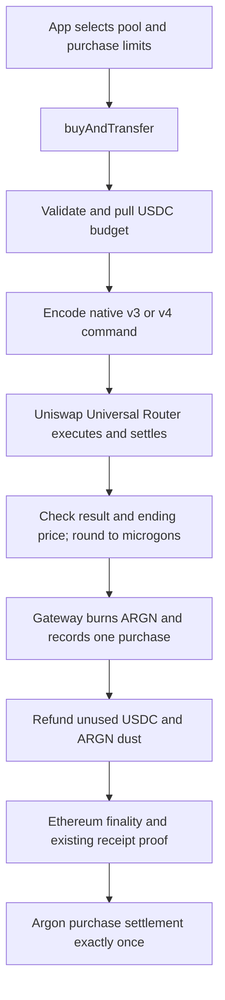

# Uniswap Buy and Transfer - Plan

## Goal Capsule

**Objective:** A user can spend USDC to purchase ARGN through Uniswap v3 or v4 and receive the
corresponding Argons on Argon, with enforceable spending and price limits.

**Means:** One `buyAndTransfer` entry point in a small non-upgradeable purchase contract, calls to
Uniswap's deployed Universal Router for either version, and one new gateway activity (KTD1–KTD5).

**Code constraint:** Minimize handwritten production code and gateway changes. Uniswap's native
contracts must own swap execution, callbacks, and settlement. Reimplementing those mechanisms is a
failed implementation, even if tests pass. Remove unused migration machinery while preserving the
initial-balance path used by Apps.

**Authority:** Product requirements below govern behavior. Technical decisions govern implementation
within those requirements. This document authorizes no deployment, gateway upgrade, staging, commit,
or push. Current work is planning only.

**Delivery boundary:** The purchase flow and bounded Ethereum migration cleanup are the
implementation targets. Oracle observations and liquidity reward registration have separate
follow-on boundaries below. Implementation must preserve unrelated staged and unstaged work in the
checkout.

---

## Product Contract

### Summary

Expose one purchase API for v3 and v4. The app selects an existing pool when quoting the purchase.
The purchase contract executes the swap, burns the purchased whole microgons through MintingGateway,
and returns unused USDC and fractional ARGN to the buyer. Argon settles one distinct Uniswap
purchase-transfer activity after Ethereum finality.

### Problem Frame

The planned app feature needs purchases across both Uniswap versions without making users handle
different transfer workflows. Purchase facts must remain available for future below-target buying
rewards. This purchase kind must remain separate from operational transfers and their eligibility
accounting.

### Key Decisions

- Use purchase-and-transfer terminology. Governs R1. (session-settled: user-directed — chosen over
  bridge terminology: this is a specific Uniswap purchase operation.)
- Select pools when buying. Governs R2. (session-settled: user-directed — chosen over fixing one
  pool and fee for all purchases: the app will quote and drive each purchase.)
- Keep purchase transfers distinct from operational transfers. Governs R7. (session-settled:
  user-directed — chosen over sharing operational classification: these are different operations.)
- Keep liquidity positions in users' wallets. Governs R9. (session-settled: user-directed — chosen
  over an NFT-holding proxy: the reward design should avoid custody.)
- Minimize purchase-contract code and gateway changes. Governs R11. (session-settled: user-directed
  — the purchase contract should contain as little code as possible, and the gateway should change
  very little.)
- Use Uniswap's native contracts for swaps. Governs R12. (session-settled: user-directed — custom
  swap execution or settlement is unacceptable.)
- Remove unused migration machinery while preserving initial balances in Apps. Governs R13.
  (session-settled: user-directed — historical code can be referenced in Git; unused contract code
  need not remain if removal is compatible.)

### Requirements

**Buying**

- R1. `buyAndTransfer` buys canonical ARGN with canonical USDC and starts delivery to the supplied
  Argon account.
- R2. Both v3 and v4 purchases use a pool selected per call; selecting a pool chooses its existing
  fee configuration, rather than changing that pool's fee.
- R3. The buyer controls a maximum USDC spend, minimum whole microgons delivered, ending pool price
  boundary, and deadline.
- R4. Reject the entire transaction if the native swap's result violates the minimum output or
  ending price boundary. Refund any input the native router leaves unspent. Do not implement custom
  stop-at-price partial execution.
- R5. Swap, Ethereum burn, and refunds succeed atomically; any failure reverts that Ethereum
  transaction.
- R6. Unused USDC and output smaller than one microgon return to the caller; previously transferred
  contract funds cannot become another buyer's output or refund.

**Settlement and scope**

- R7. A successful purchase produces one combined gateway activity and one Argon purchase
  settlement, without operational-transfer credit now or on a later account refresh.
- R8. Purchase evidence identifies the buyer, Argon recipient, actual spend/output, pool
  version/identity, and pool prices immediately before and after execution.
- R9. Future liquidity rewards use eligible v4 pools with mandatory Argon recording hooks and
  user-owned position NFTs; this purchase contract does not hold or manage positions.
- R10. Buy rewards from Treasury rewards while below target, liquidity reward calculations, and LP
  ownership/registration rules remain follow-on work.
- R11. Keep the purchase contract limited to validation, native router input encoding and approvals,
  result checks, gateway burn, and refunds. Gateway additions are limited to authenticating the
  purchase contract, burning canonical ARGN, and recording the distinct purchase activity through
  existing machinery.
- R12. Use the deployed Uniswap Universal Router and Permit2 with their matching official
  interfaces/types. Our purchase contract must not implement swap callbacks, v4 unlock/settlement,
  AMM math, or a custom router, including through copied or inherited router implementations.
- R13. Remove obsolete Ethereum migration tooling and unused contract code after tracing callers.
  Preserve Apps initial-balance setup and repeat-run behavior, fresh deployments, and proxy storage
  compatibility. Leave a pinned Git-history reference for removed machinery.

### Acceptance Examples

- AE1. Given either supported version and enough liquidity, a purchase consumes no more than its
  budget and eventually credits the Argon recipient exactly once. Covers R1–R3, R7.
- AE2. Given a swap whose ending price crosses the buyer's boundary or whose rounded output misses
  the minimum, the entire Ethereum transaction reverts. Any input the native router leaves unused in
  an otherwise valid purchase is refunded. Covers R3–R6.
- AE3. Given a completed purchase and an operational account registered or refreshed later, the
  purchase still does not increase that account's operational transfer total. Covers R7.
- AE4. Given a supported v4 observation hook, purchasing works with the same API and without
  creating an LP position or reward claim. Covers R2, R9–R10.
- AE5. Given a fresh Apps development environment, initial ARGN/ARGNOT reserves and their Argon
  backing are created successfully; repeating setup does not mint them again. Covers R13.

### Scope Boundaries

The purchase contract handles one USDC/ARGN pool per call. Multi-hop routes, split routes, arbitrary
router calldata, other input assets, exact-output purchases, and dynamic fees are excluded from this
first implementation. They are not needed to select between supported pools at purchase time; a
demonstrated app requirement would reopen those choices.

### Deferred to Follow-Up Work

- The Argon v4 hook's implementation and deployment, including price/liquidity observation history
  for the Rust oracle.
- Oracle aggregation across v3 and approved v4 observations. Reading v4 spot state must not replace
  the current time-averaged price and liquidity behavior.
- LP enrollment, position ownership changes, reward periods, and proof of complete hook history
  through a finalized reward cutoff.
- Treasury-funded below-target purchase rewards and their eligibility calculations.
- The Apps purchase UI. This plan supplies its contract ABI, typed client interfaces, event
  decoding, and proof path in Mainchain.

---

## Planning Contract

### Assumptions

The initial implementation uses fixed-fee pools, native exact-input purchases within the supplied
budget, and one pool per call. The app chooses the pool and translates the user's ending price
ceiling into the correctly oriented square-root price bound. Users need not enter Uniswap version,
tick spacing, or hook addresses themselves.

The native-contract requirement supersedes the earlier direct-core design and its stop-at-price
partial-fill promise. Universal Router does not expose that pool-level stop parameter. Minimum
output is enforced by the native router; a simple before/after pool-state check in our wrapper
enforces the ending price boundary by reverting the whole purchase. This preserves the price ceiling
without writing a swap executor. An average execution-price limit is not the same as an ending
pool-price limit.

### Key Technical Decisions

- KTD1. **One external purchase function.** Use `buyAndTransfer(request, pool)` with typed
  fixed-size structures. Version selects the native router command to encode; the rest of the
  lifecycle is shared. No separate public v3/v4 functions or arbitrary caller-supplied command
  bytes.
- KTD2. **Call the deployed Universal Router for both versions.** Encode one `V3_SWAP_EXACT_IN`
  command for v3, or one `V4_SWAP` command containing the official single-pool swap/payment/output
  actions for v4. Uniswap owns every pool callback and v4 settlement operation. Use the deadline
  overload of `execute`, with command failure allowed to revert the entire purchase. Pin the chain's
  supported router deployment and matching ABI/dependencies; target Universal Router 2.1.2 where
  supported, not an unverified repository `main` build. See
  [Universal Router overview](https://developers.uniswap.org/docs/protocols/universal-router/overview),
  [commands](https://developers.uniswap.org/docs/protocols/universal-router/concepts/commands), and
  [deployments](https://developers.uniswap.org/docs/protocols/v4/deployments).
- KTD3. **Immutable purchase authority.** MintingGateway gains one immutable `swapContract` address
  and `burnFromSwap` accepts calls only from it. The purchase contract fixes the gateway proxy,
  canonical tokens, native router/Permit2, protocol state-reading addresses, and supported Argon
  hook. Replacing purchase logic requires a new deployment and explicit gateway implementation
  upgrade. (session-settled: user-approved — chosen over routing inside the gateway or a mutable
  gateway allowlist: keep the purchase implementation separate and its authority explicit.)
- KTD4. **Narrow v4 hook support.** Accept hookless pools and one exact reviewed, non-upgradeable
  Argon observation/recording hook. Reject foreign hooks and dynamic-fee encoding. The Argon hook
  must not return swap deltas, execute nested trades, or require swap `hookData`; pass empty data.
  Address permission bits alone do not establish these semantics. See
  [v4 hook dispatch](https://github.com/Uniswap/v4-core/blob/v4.0.0/src/libraries/Hooks.sol).
- KTD5. **One canonical purchase record.** Add a new gateway event/activity tag and Rust variant,
  with the tagged pool identity below. Bind every field to the existing activity hash domain and
  nonce/root. Do not also emit the ordinary inbound-transfer activity. Reuse low-level circulation
  checks and issuance movement while giving this activity its own settlement classification.
- KTD6. **Keep purchases out of operational totals.** Do not call `record_transfer_in` or the
  operational callback for purchases: `TransferTotalsByAccount.microgons_in` currently feeds
  `UniswapTransferProvider`, including later registration and refresh. The distinct purchase event
  and existing activity processing state supply the current record and replay protection. Do not add
  purchase aggregate storage or counters without a concrete consumer in this task. Governs
  implementation of R7 and R11.
- KTD7. **Use existing proof and recovery owners.** Extend the closed activity registries, ABI/hash
  implementations, and ordered settlement handler. Keep receipt construction, finality, cursors,
  replay prevention, pause, and retry in their current owners. There is no separate v3/v4 proof API.

Use official protocol interfaces/types and established token/security utilities. Our only
version-specific logic constructs the native router inputs and reads the selected pool's price.
There are no swap callbacks or callback context in our contract. Keep only immutable configuration
and a standard reentrancy guard; no custom adapter contracts, registries, or plugin system. There is
no purchase history, rewards ledger, position tracking, pool discovery, quotation, or oracle
calculation in this contract. The app selects and quotes the pool.

Gateway additions consist of the immutable authorized purchase address and constructor wiring, the
restricted `burnFromSwap` entry, and the new event/domain-tag/hash definition. Reuse token
conversion, canonical token burning, `_gatewayActivityState`, and `_recordActivity`; add no Uniswap
dependency, pool validation, per-purchase storage, or new activity-processing mechanism there.
Remove demonstrably unused code under U6 rather than preserving it for history. Do not delete or
repurpose existing proxy storage slots. Any shared extraction must remove real duplication;
necessary caller authentication, amount checks, and atomicity remain part of the minimal
implementation.

### Purchase API

Directional interface shape for review:

```text
buyAndTransfer(request, pool)
  -> (microgonsOut, gatewayActivityNonce)

request:
  argonAccountId        bytes32
  maxUsdcIn             uint128   // USDC base units
  minMicrogonsOut        uint128   // after rounding to Argon precision
  sqrtPriceLimitX96     uint160   // ending price bound, not a native swap-stop parameter
  deadline              uint256   // Ethereum timestamp

pool:
  version               V3 | V4
  fee                   uint24
  tickSpacing           int24
  hooks                 address
```

For v3, `tickSpacing` and `hooks` must be zero. Resolve the real pool from the fixed factory and
token pair using `fee`, then verify initialization. For v4, derive sorted currencies from the fixed
pair and construct the real `PoolKey` with the supplied fee, tick spacing, and permitted hook.
Identify its initialized state in the fixed PoolManager. Reject unknown versions and
invalid/unsupported descriptors before pulling funds.

Require positive budget and minimum output, with checked conversion into the pinned router's amount
types; the microgon minimum multiplied by `10^12` must fit its token-unit minimum-output field.
Reject invalid or already-crossed price bounds and expired deadlines; equality with the current
timestamp is permitted. For USDC as token0, require the final square-root price to remain at or
above the lower bound; for USDC as token1, at or below the upper bound. Equality at the final
boundary is valid. Direction is derived from currency ordering, never supplied by the caller. No
arbitrary payer, output recipient, router address, command stream, or hook data is accepted.

The client can expose a discriminated v3/v4 pool type and encode this one ABI. It fills v3-only
unused fields with zero. Quoting remains off-chain using the corresponding Uniswap tools; a quoted
amount is not authoritative execution evidence.

### Execution and State Ownership



The Ethereum transaction includes validation through refunds. A later Argon delay does not rerun the
purchase; existing relayers retry the committed activity.

The shared outer flow is:

1. Enter the standard reentrancy guard, validate the selected pool/request, and snapshot USDC/ARGN
   balances.
2. Pull the budget from the caller using standard USDC allowance. Authorize only that budget through
   native Permit2 to the fixed Universal Router, with a bounded expiry. No buyer permit/signature
   flow is required for this API.
3. Read the starting pool price through the official interface/view, build the fixed native command,
   and call `execute(commands, inputs, deadline)`. The router pulls USDC from this purchase contract
   and sends ARGN back to it. Read the ending price and revert if it crosses the boundary.
4. Measure actual USDC spent and ARGN received from balance changes, isolating all pre-existing
   balances. Clear unused router/Permit2 spending allowance. Do not pre-fund or sweep the router's
   global balance.
5. Compute `microgonsOut = argonBought / 10^12`, reject zero/overflow/insufficient output, and
   approve the gateway for exactly `microgonsOut * 10^12` ARGN units.
6. Call `burnFromSwap` with measured purchase facts. The gateway derives the amount, burns from the
   purchase contract, snapshots post-burn circulation, and records the new activity.
7. Refund this call's unused USDC and ARGN remainder to the caller. Successful completion leaves
   original contract balances intact and no residual purchase spending allowance.

Only the native command and pool-state read differ:

| Detail                        | v3                                              | v4                                                                                   |
| ----------------------------- | ----------------------------------------------- | ------------------------------------------------------------------------------------ |
| Router command                | `V3_SWAP_EXACT_IN` with one USDC/fee/ARGN path  | `V4_SWAP` with official `SWAP_EXACT_IN_SINGLE`, `SETTLE_ALL`, and `TAKE_ALL` actions |
| Payment/output                | Purchase contract is payer and output recipient | Purchase contract is router caller, payer, and output recipient                      |
| Price observation             | Canonical factory-resolved pool's `slot0`       | Official v4 StateView for the derived PoolId                                         |
| Callback and settlement owner | Uniswap Universal Router                        | Uniswap Universal Router                                                             |

Use the pinned router's official constants and parameter types; their layouts can differ by release.
The caller cannot supply commands, recipients, payment sources, or allow-revert flags. Native
commands are ordinary ABI encoding, not a new execution engine. The hook remains an observer. See
the
[official v4 router integration](https://developers.uniswap.org/docs/protocols/v4/guides/swapping/swapping)
and
[Permit2 allowance implementation](https://github.com/Uniswap/permit2/blob/main/src/AllowanceTransfer.sol).

### Gateway Activity and Argon Accounting

`burnFromSwap` accepts measured purchase facts only from KTD3's address. It must respect gateway
pause state, burn only canonical ARGN held by the caller, and emit a distinct
`TransferToArgonFromSwapStarted` activity. It does not accept USDC or invoke Uniswap.

The record contains buyer (`msg.sender` at purchase entry, including a smart wallet), Argon
recipient, canonical token addresses, actual USDC spent, ARGN bought before dust rounding, whole
microgons burned, pre/post square-root prices, and the existing `GatewayActivityState`.

Use the following tagged pool identity in both the event and its activity hash:

| Field     | v3 meaning                            | v4 meaning                        |
| --------- | ------------------------------------- | --------------------------------- |
| `version` | V3                                    | V4                                |
| `venue`   | Immutable v3 factory                  | Immutable v4 PoolManager          |
| `poolId`  | Pool address zero-extended to bytes32 | Hash of the complete real PoolKey |

The chain and gateway are already bound by the activity hash domain. A v4 pool is never represented
as if it had its own contract address. Do not add a second stored copy of the full PoolKey to this
event solely for display; pool discovery can supply metadata.

On Argon, validate the new activity and canonical ARGN, apply the same circulation reconciliation as
an ARGN inbound, and reuse `mint_to` for the balance movement. Emit a distinct settlement event
without writing operational totals or adding speculative purchase totals. R7 applies both
immediately and when an operational account later queries its provider.

Keep the existing ordinary event encodings and activity-hash version unchanged; use a new domain tag
for the additive purchase event. Solidity, TypeScript, and Rust need matching hash vectors.

### Compatibility with the Follow-On Hook

The purchase ABI already carries the v4 hook identity; LP enrollment belongs in a separate API. The
eventual hook may record price observations and LP changes, but buying must not imply enrollment or
reward eligibility.

An immutable purchase contract cannot approve an unknown future hook automatically. If the reviewed
hook exists before purchase deployment, bind its exact address. Otherwise deploy with hook support
disabled, then deploy a replacement purchase contract and explicitly upgrade the gateway when the
reviewed hook is available. The external purchase ABI stays the same. This is deployment sequencing,
not a runtime switch or hook setter.

Before creating or moving reward-bearing liquidity into a v4 pool, complete its oracle-history
design. Current `oracle/src/uniswap_oracle.rs` reads v3 cumulative tick and seconds-per-liquidity
observations; bare v4 state lacks that history. The pool's hook is fixed at creation. V3 oracle
coverage can continue while v4 buying is implemented, but v4 liquidity must not be counted as
observed until the history reader is qualified.

NFT transfers do not invoke liquidity hooks. The LP follow-on must decide how reward recipients
change with ownership and provide enforceable ownership updates or suitable ownership proofs.
Optional subscribers alone cannot guarantee exit recording because unsubscription can swallow
callback failure. Proving a hook's old event also does not prove completeness: Argon needs a
commitment authenticated at the chosen finalized cutoff. None of these unresolved LP choices blocks
the purchase API.

### Receipt Capacity and Activation

The selected event must fit the 1,024-byte log-data bound, and the full Ethereum receipt leaf must
fit the receipt proof-node bound. Current nodes are limited to 2,048 bytes. Swaps, approvals,
refunds, hooks, and wallet calls add logs outside the selected event.

Qualify real v3 and v4 receipts through the actual client proof builder and runtime verifier. Use
4,096-byte nodes and five proof blocks per extrinsic as the initial sizing proposal, replacing the
current ten-block batch only if the measured receipts require it. The encoded-size assertion and
benchmark weights must validate the chosen pair of limits. Do not promise support for arbitrarily
large wallet batches.

Deploy runtime and relayer/client recognition before enabling the new gateway event; an unknown
activity can pause the common ordered stream. Deploy the purchase contract against the existing
proxy, then the gateway implementation bound to the purchase address, then perform the separately
authorized proxy upgrade. Preserve all gateway storage and prior nonce/root state. The current
`prepareMintingGatewayUpgrade.ts` deploys an implementation; it is not a read-only preview.

---

## Implementation Units

### U1. Add the purchase activity and gateway burn boundary

**Goal:** Authenticate one purchase contract and record one atomic burn with complete purchase
evidence.

**Requirements:** R5, R7–R8, R11; KTD3, KTD5. **Dependencies:** None.

**Files:** `chains/ethereum/contracts/contracts/MintingGateway.sol`,
`chains/ethereum/contracts/hashing.ts`, `chains/ethereum/contracts/rust/src/minting_gateway.rs`,
generated contract bindings/artifacts, `chains/ethereum/contracts/test/MintingGateway.test.ts`.

**Approach:** Add only the immutable authority, new event/tag/hash, and allowance-based burn entry
described above. Reuse existing activity recording and circulation conversion without invoking the
old permit/operational event path. Update constructor fixtures and preserve proxy storage layout; no
new mutable gateway storage is required.

**Test scenarios:**

- Unauthorized callers cannot burn or append an activity.
- The authorized contract burns only its canonical ARGN allowance and produces one nonce increment.
- Gateway pause or failed burn leaves circulation, activity root, and nonce unchanged.
- Mutation of each purchase field changes the activity hash consistently in all three languages.
- An upgrade preserves existing gateway state and the old inbound operation.

**Verification:** Contract behavior and cross-language hash vectors agree; old activity encodings
still pass their existing tests.

### U2. Implement the thin purchase wrapper with native v3 routing

**Goal:** Deliver AE1–AE2 through the shared public API using v3.

**Requirements:** R1–R6, R8, R11–R12; KTD1–KTD3. **Dependencies:** U1.

**Files:** New `chains/ethereum/contracts/contracts/UniswapPurchase.sol`, pinned Uniswap
interfaces/dependencies in `chains/ethereum/contracts/package.json`, contract exports/codegen
configuration, new `chains/ethereum/contracts/test/UniswapPurchase.test.ts`.

**Approach:** Implement the outer lifecycle and encode the native router's single-pool v3 command.
Use official interfaces, Permit2 approval calls, and SafeERC20 operations. No direct pool swap, swap
callback, or custom routing/payment engine. Keep balance/refund/burn logic shared.

**Test scenarios:**

- The pinned native Universal Router executes purchases against a real v3 pool with both token
  orderings. Covers AE1–AE2.
- Rounding leaves the exact microgon amount for Argon and refunds less than `10^12` ARGN units.
- Existing contract balances survive purchases by successive buyers unchanged.
- Invalid descriptor, expired deadline, exceeded ending price limit, and zero rounded output revert.
- The fixed native command pays only canonical USDC, sends ARGN only to the purchase contract, and
  cannot redirect spending to caller-selected addresses; unused allowances are cleared.
- Insufficient minimum output, failed gateway burn, and failed refund revert the swap and activity
  together.

**Verification:** Real native-router execution demonstrates spending and output bounds, ending price
rejection, and atomic burn/refunds; mock-only swap results are insufficient.

### U3. Add native v4 command encoding behind the same API

**Goal:** Deliver the same user-visible purchase behavior through v4.

**Requirements:** R1–R6, R8–R9, R11–R12; KTD1–KTD4. **Dependencies:** U2.

**Files:** `chains/ethereum/contracts/contracts/UniswapPurchase.sol`, package/compiler test
configuration as required for pinned v4 fixtures,
`chains/ethereum/contracts/test/UniswapPurchase.test.ts`, focused protocol fixtures under
`chains/ethereum/contracts/contracts/test/` if needed.

**Approach:** Build the official PoolKey and native action parameters, read state through the
official StateView, and call the same Universal Router. The native router performs v4 unlocking,
swaps, settlement, and collection. Our contract only encodes those actions, enforces KTD4, and
checks the resulting balances and ending price.

**Test scenarios:**

- Real v4 pools match AE1–AE2 for both token orderings, with hookless and supported observation-hook
  fixtures.
- Unset pool, foreign hook, dynamic-fee encoding, and amounts outside the native ABI bounds revert.
- Native action encoding uses the canonical currencies, fixed payer/recipient, input cap, and
  token-unit output minimum; the supported router deployment executes that exact encoding.
- Hook reentry or revert cannot append a purchase or retain the buyer's funds.
- The v3 and v4 paths share output rounding, refunds, allowance cleanup, deadline, minimum output,
  and ending price checks.

**Verification:** Execute through the pinned native router and real v4 core, including
representative deployed-contract qualification. Use official releases matching selected chain
deployments; repository `main` or copied guide snippets alone are not ABI evidence. No custom
callback/settlement implementation is acceptable.

### U4. Settle purchases independently on Argon

**Goal:** Credit the recipient exactly once without affecting operational eligibility.

**Requirements:** R7–R8; KTD5–KTD7. **Dependencies:** U1.

**Files:** `pallets/crosschain_transfer/src/evm.rs`, `gateway_activity.rs` including its tests,
`lib.rs`, pallet benchmarking/weights, `pallets/operational_accounts/src/tests.rs`, generated
runtime metadata/client types as needed.

**Approach:** Extend activity decoding and dispatch, reuse circulation and `mint_to` behavior, and
emit the separate purchase settlement without adding operational credit or purchase aggregate
storage. Preserve per-activity transactional rollback and the existing stream's pause/retry owners.

**Test scenarios:**

- Mixed old and purchase activities settle in order; replay cannot mint again. Covers AE1.
- Purchase credit leaves operational totals unchanged immediately and after later
  registration/refresh. Covers AE3.
- Circulation mismatch or insufficient backing pauses without partially applying the failing
  purchase.
- Restart and retry after a pause preserve previously applied activities and apply the pending
  purchase once.

**Verification:** New settlement and existing operational-transfer tests agree on their separate
accounting semantics.

### U5. Complete client proof support, receipt qualification, and rollout artifacts

**Goal:** Make purchases discoverable and provable through the existing client and relayer
lifecycle.

**Requirements:** R2, R5, R7–R8; KTD7. **Dependencies:** U1–U4.

**Files:** `client/nodejs/src/EthereumGatewayActivity.ts`, `EthereumGatewayActivityProof.ts` only
where required, corresponding `__test__/EthereumGatewayActivity.test.ts`, `EthereumProof.test.ts`,
`ethereum.e2e.test.ts`; `primitives/src/ethereum.rs`, verifier/pallet benchmarks and weights if
sizing changes; `runtime/common/src/config.rs`; `chains/ethereum/deploy/index.ts`,
`prepareMintingGatewayUpgrade.ts`; `docs/chain-transfers.md`.

**Approach:** Add the new closed-union/event-registry member and appropriately named purchase
discovery entry without widening the existing operational-specific helper. Generate real receipts
from U2/U3 and qualify them end to end. Prepare deployment configuration/manifests for KTD3 without
executing deployment during development review.

**Test scenarios:**

- Each version's successful purchase, unused-input refund where produced by the native router, and
  dust receipt is discovered, serialized, verified, and settled through the existing proof path,
  including native Permit2 logs.
- A representative supported wallet call and supported hook receipt fit the selected bounds;
  oversize receipts fail explicitly.
- Mixed gateway activity discovery remains contiguous across restart/backfill.
- Maximum encoded proof batches fit the runtime limit after any bound adjustment.
- The purchase contract fails atomically before gateway activation and succeeds after the qualified
  upgrade in a local fixture.

**Verification:** Runtime, contract package, client, and representative proof actors agree on the
new event. Upgrade manifests resolve both immutable address directions and preserve canonical
token/proxy identities.

### U6. Remove obsolete migration machinery and preserve initial balances

**Goal:** Retire historical Ethereum migration tooling while keeping the small initialization path
still used by Apps and contract fixtures.

**Requirements:** R11, R13. **Dependencies:** Caller tracing before deletion; coordinate any ABI
changes with Apps and regenerated bindings.

**Confirmed live caller:** `apps/e2e/devEthereumRuntimeSetup.ts` calls
`initializeDevEthereumTokenReserve`, reads `migrationCompleted`, finalizes Argon backing, invokes
`migrate` with one recipient for each asset, waits for success, and checks both balances.
`chains/ethereum/deploy/measure.ts` and contract fixtures also use `migrate` to seed balances. These
entry points are currently used, not historical dead code.

**Files:** `chains/ethereum/deploy/index.ts`, `measure.ts`, deploy README/checklist,
`mainnet/migration/`, and demonstrably unused migration declarations/helpers in `MintingGateway.sol`
and associated bindings/tests. Apps setup and its existing e2e tests are compatibility consumers;
coordinate edits there only if the retained initialization ABI changes.

**Approach:**

- Remove the old mainnet recovery-bundle loader, distribution/provenance assembly, and automatic
  historical migration transaction from current deployment generation. Replace archived
  bundle/provenance files with a short README pointing to Git history. Keep ordinary deployment,
  runtime configuration, upgrade preparation, and gas measurement commands working.
- Keep the smallest working initial-balance path. Prefer retaining the existing small, owner-only,
  once-only initialization entry and getter rather than introducing a new minting mechanism just to
  remove the word migration. Remove contract functions, events, types, or helpers only when no
  remaining runtime/bootstrap/test consumer needs them; historical reconstruction belongs in Git.
- If simplifying initialization changes its ABI, update Apps and fixtures together and retain the
  backing-before-mint ordering, both-asset seeding, authorization, and repeat-run protection. Do not
  replace it with an unrestricted production mint function.
- Preserve deployed proxy storage layout even when executable code is removed: retired slots may
  need reserved declarations. Historical deployment manifests remain audit records, not current
  executable migration instructions.

**History pointer:** The complete pre-cleanup implementation and bundle are available at commit
`7eb80ba8ea114ae91b6eb987e374a5725f88d8ec`. For example,
`git show 7eb80ba8ea114ae91b6eb987e374a5725f88d8ec:chains/ethereum/deploy/index.ts`; use the same
commit with `chains/ethereum/deploy/mainnet/migration/` paths. The bundle path was verified in that
commit during planning.

**Verification:** Apps fresh setup and repeated setup cover AE5; contract fixtures and local gas
measurement still initialize balances; deployment generation no longer references deleted bundles;
ABI consumers compile and proxy storage layout remains compatible. No deployment commands run
against a live network as part of cleanup.

---

## Verification Contract

Implementation verification uses the existing repository suites, with new tests in the units above:

- `yarn workspace @argonprotocol/ethereum-contracts build`, `codegen`, and `test` for contracts and
  ABI output.
- `cargo test -p argon-ethereum-contracts` for Rust event/hash parity.
- `cargo test -p pallet-crosschain-transfer` and relevant operational-account tests for
  settlement/accounting.
- `cargo test -p pallet-ethereum-verifier` plus the real TypeScript receipt/e2e suites for proof
  interoperability.
- `cargo test -p argon-runtime-common gateway_activity_proof_batch_bound_fits_normal_extrinsic_limit`
  for any size/batch changes.
- `cargo make fmt` for Rust formatting, and regenerate/compile runtime clients when metadata
  changes.

Use real Uniswap Universal Router, Permit2, and v3/v4 fixtures matching the selected deployment
APIs; mocks cannot establish compatibility. Run the existing Apps initial-balance setup tests for
U6, including fresh and repeated setup. Regenerate runtime weights if proof bounds or measured paths
change. Run an independent correctness/readability review before deployment approval. The earlier
document review covered the direct-core draft; this native-router revision needs its own
implementation review. Planning has not run implementation checks or changed production code.

---

## Definition of Done

- One public purchase ABI uses deployed native Uniswap contracts for both versions, with AE1–AE4
  covered for supported configurations. No handwritten swap callbacks, v4 settlement engine, AMM
  math, or custom router.
- Ethereum swap/burn/refund failures are atomic; delayed Argon settlement is recoverable and exactly
  once.
- Purchase accounting never becomes operational credit through immediate or later reads.
- Actual receipts pass the chosen verifier bounds and batch-size guard.
- Canonical ABIs, event hashes, clients, runtime handling, and upgrade configuration agree.
- Deployment gates, supported pool/hook policy, and follow-on LP/oracle boundaries are documented.
- Unnecessary wrappers, duplicate types/state, and abandoned implementation attempts are removed.
- Review the handwritten Solidity diff against R11–R12: a focused native-router wrapper and only the
  authorization, burn entry, and activity definition added to the gateway. Report additions and
  removal of unused code separately from tests/generated bindings; do not hide complexity in
  additional custom contracts or remove necessary security checks to reduce line count.
- Obsolete migration machinery is replaced by a pinned history pointer; Apps initial balances and
  repeat-run behavior still pass AE5, and proxy storage layout is preserved.
- Reviewers can inspect the patch without staging, committing, pushing, or deploying it
  automatically.

---

## Sources

- `chains/ethereum/contracts/contracts/MintingGateway.sol`: existing allowance/permit burn,
  implementation immutables, and ordered activity recording.
- `pallets/crosschain_transfer/src/gateway_activity.rs` and `lib.rs`: settlement rollback,
  circulation checks, durable totals, and operational provider.
- `client/nodejs/src/EthereumGatewayActivity.ts` and `EthereumGatewayActivityProof.ts`: closed
  activity recognition and contiguous proof discovery.
- `primitives/src/ethereum.rs` and `runtime/common/src/config.rs`: receipt and encoded batch bounds.
- `oracle/src/uniswap_oracle.rs`: existing time-averaged price/liquidity calculation.
- `apps/e2e/devEthereumRuntimeSetup.ts` in the sibling Apps checkout: live initial-balance and
  once-only migration consumer; inspected during planning.
- [Universal Router](https://developers.uniswap.org/docs/protocols/universal-router/overview),
  [native swap integration](https://developers.uniswap.org/docs/protocols/v4/guides/swapping/swapping),
  and
  [command definitions](https://developers.uniswap.org/docs/protocols/universal-router/concepts/commands):
  use deployed native execution and official command encoding.
- [V4Router implementation](https://github.com/Uniswap/v4-periphery/blob/main/src/V4Router.sol) and
  [native parameter types](https://github.com/Uniswap/v4-periphery/blob/main/src/interfaces/IV4Router.sol):
  minimum-output checks do not provide a caller-selected pool-price stop; pin the actual
  deployment's ABI before implementation.
- [Uniswap v4 core v4.0.0](https://github.com/Uniswap/v4-core/tree/v4.0.0),
  [PoolKey](https://github.com/Uniswap/v4-core/blob/v4.0.0/src/types/PoolKey.sol), and
  [StateLibrary](https://github.com/Uniswap/v4-core/blob/v4.0.0/src/libraries/StateLibrary.sol):
  pool identity and core execution/state interfaces.
- [PositionManager](https://github.com/Uniswap/v4-periphery/blob/main/src/PositionManager.sol) and
  [Notifier](https://github.com/Uniswap/v4-periphery/blob/main/src/base/Notifier.sol): LP follow-on
  ownership and unsubscribe limitations; verify against the selected deployment before that work
  begins.
- [Uniswap oracle documentation](https://developers.uniswap.org/docs/protocols/v3/concepts/price-oracles):
  v3 history and the absence of native v4 observations.
